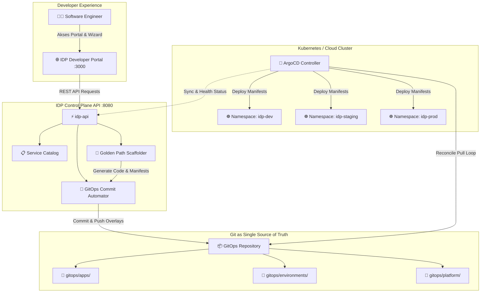

# Arsitektur GitOpsIdp (GitOps-Driven Internal Developer Platform)

## 1. Ikhtisar Konsep

**GitOpsIdp** menggabungkan dua pilar utama dalam disiplin modern **Platform Engineering**:

1. **Internal Developer Platform (IDP)**: Lapisan *self-service* yang membebaskan tim rekayasa perangkat lunak dari beban kognitif manajemen infrastruktur (*cognitive load*). Tim pengembang dapat melakukan *scaffolding* layanan baru, menginspeksi katalog layanan (*service catalog*), dan melihat status deployment tanpa tiket manual ke tim DevOps.
2. **GitOps**: Pola operasional berbasis Git di mana *desired state* aplikasi dan infrastruktur didefinisikan secara deklaratif di Git. Sinkronisasi dan pemulihan drift (*drift reconciliation*) dilakukan secara kontinu oleh agen GitOps (seperti ArgoCD / Flux).

---

## 2. Komponen Sistem

### A. IDP Developer Portal (`idp-portal`)
- **Teknologi**: Single Page Application (HTML5, Modern CSS, Vanilla JS / Nginx reverse proxy).
- **Fitur Utama**:
  - **Service Catalog**: Menampilkan direktori mikroservis aktif, pemilik tim (*owner*), bahasa pemrograman, dan status deployment di `dev`, `staging`, dan `prod`.
  - **Golden Path Wizard**: Formulir ramah pengguna untuk membuat microservice baru dengan konfigurasi CPU, memori, port, dan template runtime yang sudah terstandarisasi.
  - **GitOps & ArgoCD Reconciler**: Memantau commit SHA, status sinkronisasi deklaratif (*Synced*, *OutOfSync*), dan menyediakan tombol rekonsiliasi instan (*⚡ Sync Now*).
  - **Environments & Topology**: Peta promosi aplikasi antar cluster/namespace (`dev` -> `staging` -> `prod`).

### B. IDP Control Plane API (`idp-api`)
- **Teknologi**: Go (Go 1.24, zero heavy external dependency, portable binary).
- **Sub-Modul**:
  - `internal/catalog`: Membaca struktur direktori `gitops/apps/` secara dinamis. Setiap folder layanan yang didefinisikan di Git langsung didaftarkan ke katalog (*Git as the Single Source of Truth*).
  - `internal/scaffolder`: Membaca template dari `templates/`, melakukan *parameter interpolation*, menghasilkan kode mikroservis di `services/<nama>/`, membuat manifest Kustomize di `gitops/apps/<nama>/`, serta mendaftarkan overlay ke `gitops/environments/`.
  - `internal/gitops`: Memeriksa status Git lokal/remote, melakukan commit otomatis saat layanan dibuat, dan melacak rekonsiliasi ArgoCD.

### C. GitOps Manifest Hierarchy (`gitops/`)
Struktur repositori mengikuti pola *best practice* ArgoCD:
- `platform/argocd-apps/`:
  - `root-app-of-apps.yaml`: Root ArgoCD Application yang mengorkestrasi seluruh aplikasi (*App-of-Apps pattern*).
  - `applicationset-services.yaml`: ArgoCD `ApplicationSet` matrix generator yang secara otomatis mendeteksi setiap mikroservis baru di folder `gitops/apps/*` dan mendeploynya ke target namespace.
  - `idp-platform-app.yaml`: Manifest untuk mendeploy IDP Portal dan IDP API itu sendiri ke cluster (*Self-hosting GitOps*).
- `apps/<service-name>/`:
  - `base/`: Definisi Deployment, Service, ConfigMap, dan Kustomization inti yang agnostik terhadap environment.
  - `overlays/dev/`: Patch untuk environment development (1 replika, image `:dev-latest`, log level debug).
  - `overlays/staging/`: Patch untuk environment staging (2 replika, image `:rc-latest`).
  - `overlays/prod/`: Patch untuk environment production (3 replika, HorizontalPodAutoscaler, image tag spesifik).
- `environments/`:
  - Agregator Kustomize untuk deploy batch per environment (`dev/`, `staging/`, `prod/`).

---

## 3. Golden Path Templates (`templates/`)
Menyediakan cetak biru produksi (*production-ready blueprints*):
1. **Go Microservice**: Server HTTP bersih dengan liveness (`/healthz`) dan readiness (`/ready`) probes, non-root user container, dan multi-stage build.
2. **Node.js Express**: REST API dengan konfigurasi environment terisolasi dan container Alpine.
3. **Python FastAPI**: Layanan API asynchronous dengan validasi data dan OpenAPI schema.
